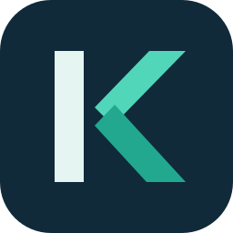

<p align="center">
  
</p>

<h1 align="center">kyojin</h1>

<p align="center"><strong>让 AI 协作遵循工程标准。</strong></p>
<p align="center">工程规范 · 角色 Skills · 协作任务视图</p>

<p align="center">
  <a href="#快速开始">快速开始</a> ·
  <a href="#按任务选择-skill">Skills 导航</a> ·
  <a href="#工程规范">工程规范</a> ·
  <a href="#survey-corps-协作流程">协作流程</a> ·
  <a href="LICENSE">Apache-2.0</a>
</p>

kyojin 是团队共用的工程标准和 AI 协作 Skill 集合。`std/` 定义工程约束，`skills/` 定义需求、开发、审查与测试的职责和交接方式；Survey Corps（调查兵团）负责按任务选择角色，并通过 MCP App 展示协作状态。

## 项目组成

| 组成 | 解决的问题 | 入口 |
|---|---|---|
| 工程规范 | 同一团队的语言、框架和专项约束分散 | [std/](std/) |
| 角色 Skills | AI 执行任务时职责、交付物和完成依据不清 | [skills/](skills/) |
| Survey Corps | 多角色任务需要编排、交接和风险升级 | [协作协议](skills/survey-corps/SKILL.md) |
| 协作任务视图 | 查看当前参与角色、状态、证据和下一步 | [MCP App](skills/survey-corps/mcp-app/README.md) |

## 快速开始

### 安装到 Codex

将以下提示词粘贴给 Codex：

> 请从 `https://github.com/fbbzl/kyojin` 安装 `codex-install.json` 中声明的所有 Skills 和 MCP Apps，并按提示完成授权与重新加载。

[codex-install.json](codex-install.json) 是完整安装清单，声明 Skills 和 `survey-corps-task-view` 插件。安装需要用户授权，必要时重新加载或重启 Codex。完整 SC 流程要求宿主支持真实独立子代理；任务视图还要求支持本地 marketplace plugin 和 MCP Apps，并可调用 `show_sc_task_view`。

安装与故障排查见 [MCP App 说明](skills/survey-corps/mcp-app/README.md)。其中包含插件注册、更新、卸载和本地验证方式。

### 开始一个任务

安装后，可在对话中明确指定 Skill 和目标：

```text
使用 req，分析订单导出需求，明确权限、数据范围和验收标准。
```

```text
使用 cr，审查当前改动，重点检查 API 契约、安全和数据一致性。
```

需要完整协作时，用 `sc` 启动 Survey Corps：

```text
sc：为当前项目增加订单导出功能，先明确验收标准，再完成开发、审查和测试。
```

只需要工程规范时，可以直接阅读 `std/`，不必安装任务视图。先读 [general.std](std/general.std)，再按项目技术栈选择语言、框架和专项规范；安装 Skills 不等于已将这些规范复制到业务项目。

## 按任务选择 Skill

| 当前任务 | Skill | 主要产出 |
|---|---|---|
| 需求不清、需要定义边界 | [req](skills/req/SKILL.md) | 用户场景、业务契约与验收标准 |
| 实现已确认的需求 | [dev](skills/dev/SKILL.md) | 实现、开发验证与恢复输入 |
| 审查代码或设计 | [cr](skills/cr/SKILL.md) | 带证据的审查项与复审结论 |
| 测试、反馈分流与 Bug 复测 | [qa](skills/qa/SKILL.md) | 测试证据、Bug 记录与验收结论 |
| 编排多角色工程任务 | [survey-corps](skills/survey-corps/SKILL.md) | 角色选择、交接与任务状态 |
| 为一个目标增加独立反证审查 | [consensus-goal](skills/consensus-goal/SKILL.md) | 独立审查意见与证据缺口 |
| 从项目代码生成 API 文档 | [create-apidocs](skills/create-apidocs/SKILL.md) | 按实际接口契约生成的文档 |
| 精修 README 或技术文档 | [humanity-tech-docs](skills/humanity-tech-docs/SKILL.md) | 事实核对与语言修订 |
| 评估 Skill 质量 | [skill-eval](skills/skill-eval/SKILL.md) | 证据化评分与最小改进项 |

每个 Skill 以带 YAML frontmatter 的 `SKILL.md` 为入口，适用条件和依赖以对应文件为准。`humanity-tech-docs` 另需安装 `technical-writer-voice` 和 `humanizer`；这些依赖不包含在本仓库中。

[subskills/](skills/subskills/) 提供角色内的专项能力，包括视觉对齐、技术选型、根因分析、行为保持重构、目标审查与目标测试。部分子技能有明确前置条件，例如 `bug-fix` 只接收 QA 已登记且可复现的 Bug，`optimize` 只接收 CR 明确交回的优化项。

## Survey Corps 协作流程

SC 按任务选择最小必要角色链。典型的需求到交付路径是：

```text
REQ 明确需求 → DEV 实现 → CR 审查 → QA 测试
                  ↑          │         │
                  └──── 修订后重新交接 ──┘
```

REQ、DEV、CR、QA 分别负责需求、实现、静态审查和独立测试。SC 流程中的参与角色必须由真实独立子代理执行；涉及代码改动时，链路必须包含 CR 和 QA。单角色任务不必启动完整 SC 流程。

任务视图随明确的编排动作更新，显示实际参与角色及其状态、摘要、证据、风险、下一步和执行耗时。视图通过 MCP App 在宿主内呈现，不使用后台轮询；它不替代权威交接记录或验收结论。视图工具不可用时，SC 流程会阻断，需恢复插件能力后继续。

协议与运行边界分别见 [Survey Corps Skill](skills/survey-corps/SKILL.md) 和 [MCP App 说明](skills/survey-corps/mcp-app/README.md)。

## 工程规范

从通用基线开始，再叠加实际使用的语言、框架与专项规范。

| 类别 | 规范 |
|---|---|
| 通用与协作 | [通用原则](std/general.std)、[Git](std/git.std) |
| 后端与系统语言 | [Java](std/java.std)、[Kotlin](std/kotlin.std)、[Scala](std/scala.std)、[Python](std/python.std)、[Go](std/go.std)、[Rust](std/rust.std)、[C#](std/csharp.std)、[C++](std/cpp.std) |
| 前端与跨端 | [前端通用](std/frontend.std)、[TypeScript](std/typescript.std)、[React](std/react.std)、[Vue](std/vue.std)、[Angular](std/angular.std)、[Flutter](std/flutter.std) |
| 后端框架 | [Spring](std/spring.std)、[FastAPI](std/fastapi.std)、[Django](std/django.std)、[NestJS](std/nestjs.std) |
| 专项 | [API 设计](std/api-design.std)、[数据库](std/database.std)、[安全](std/security.std)、[日志](std/logging.std)、[DevOps](std/devops.std) |

规则冲突时，按以下优先级处理：

```text
项目规则 / 用户指令 / AGENTS.md > std/ > 通用工程常识
```

## 仓库结构

```text
kyojin/
├── std/                       # 工程规范
├── skills/                    # 角色与专项 Skills
│   ├── survey-corps/mcp-app/   # 协作任务视图插件
│   ├── subskills/             # 角色内专项能力
│   └── validate-skills.ps1    # Skill 结构与链接校验
├── .agents/plugins/           # 本地 marketplace 清单
├── tools/                     # 插件安装与生命周期工具
├── assets/brand/              # Logo 素材
├── codex-install.json         # 完整安装清单
├── AGENTS.md                  # 本仓库 Agent 规则
└── LICENSE                    # Apache License 2.0
```

## 维护与贡献

- 跨语言规则放在 `std/general.std`，语言或框架规则放在各自文件中。
- 新增 Skill 时，保持一个目录对应一个 `SKILL.md` 的结构，写明适用条件、交付物与验证依据。
- 修改 Skill 后，在仓库根目录运行结构校验：

```powershell
pwsh -File skills/validate-skills.ps1
```

修改任务视图或安装工具时，还应运行 [MCP App 说明](skills/survey-corps/mcp-app/README.md) 中对应的验证命令。结构校验不替代行为测试。

## 许可证

本项目采用 [Apache License 2.0](LICENSE)。
